

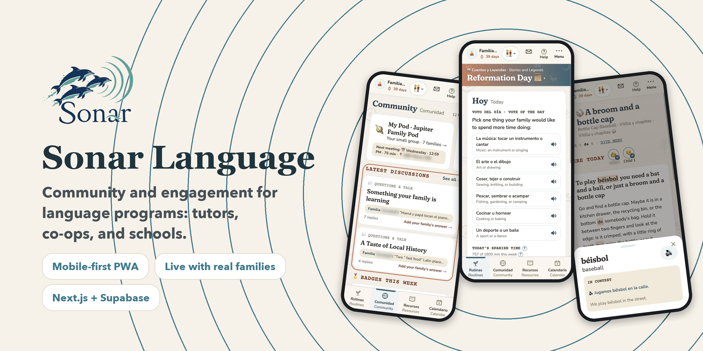

# Sonar Language

**A mobile-first community app that keeps language learners using the language between lessons.**
Built for tutors, homeschool co-ops, and language schools. Live today with a Spanish program for families.

🔒 The source code is private. I'm happy to walk through it on a call.

---

## The problem

A weekly lesson gives a learner about an hour of the language. Proficiency takes hundreds. Most of that time has to happen at home, between lessons, and that's where programs lose people. Learners drift, the group goes quiet, and the teacher can't see who needs a nudge until someone stops coming.

**Sonar is the space between lessons.** Families get a daily reason to open the app, small habits that add real minutes of the language, and a community of other families doing the same thing. The teacher gets a dashboard showing who's active, who's gone quiet, and what to do about it this week.

## Who it's for

| | |
|---|---|
| 🧑‍🏫 **Tutors and small programs** | Run a "pod" (a small cohort) with its own chat, meeting schedule, announcements, and attendance. |
| 🏫 **Schools and co-ops** | Run several pods under one community, with shared resources, a content calendar, and engagement analytics across every group. |
| 👨‍👩‍👧 **Families** | One login per household, a profile for each person (grown ups and kids), and a daily routine that fits around breakfast, the drive, and bedtime. |

## Proof it works

The app is in production with a real Spanish program. These numbers come straight from the live database:

| 10 | 8 of 10 | 754 | 75 | Aug 2026 |
|:---:|:---:|:---:|:---:|:---:|
| **families** in **2 pods** | **families active** in the last 30 days | **minutes of Spanish logged** in the last 30 days | **habit check-ins** in the last 30 days | **live since** |

| 481 | 25 | 79 | 292 | ~2,000 |
|:---:|:---:|:---:|:---:|:---:|
| **curated resources** | **reading courses ("dives")** | **cultural holidays** | **daily polls scheduled** | **commits since July 2026** |

> Every screenshot below comes from the **live production app**, captured on a phone-sized viewport. Real families use it, so their names, photos, and locations are blurred.

---

## Feature tour

### 1. A daily reason to open the app

The **Hoy** (Today) screen is the front door. It has a one-tap poll with audio for every answer, the family's Spanish minutes against a weekly goal, today's habits to check off, and the next reading course. It takes under a minute, and every tap adds Spanish to the day.

<table>
  <tr>
    <td align="center" width="33%">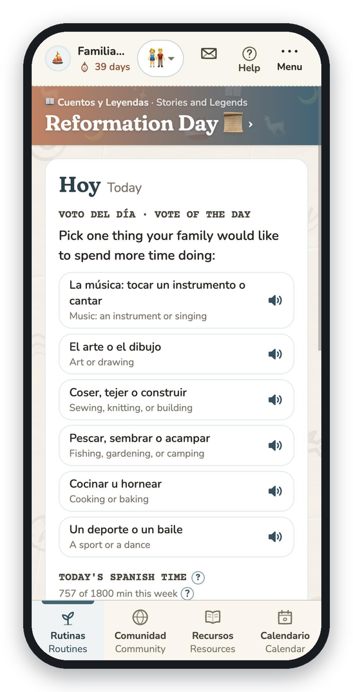 <b>Daily poll</b>: bilingual answers, tap to hear each one</td>
    <td align="center" width="33%">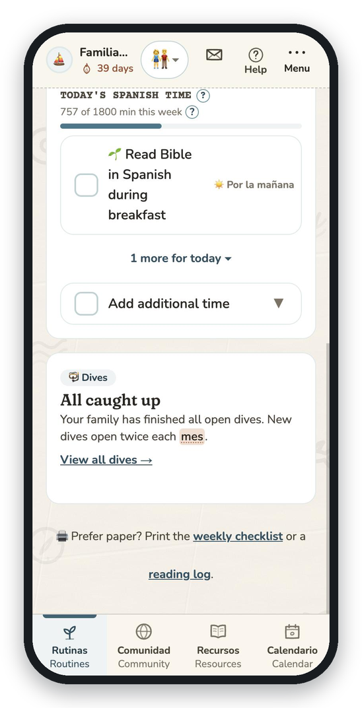 <b>Spanish time</b>: weekly minutes, today's habits, and the dive queue</td>
    <td align="center" width="33%">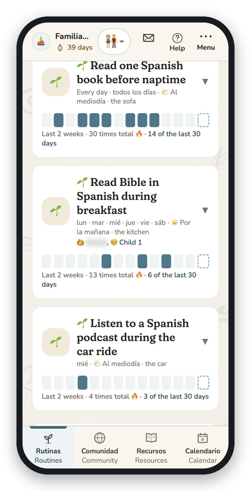 <b>Habit builder</b>: each habit is tied to a moment and tracked over 14 days</td>
  </tr>
</table>

### 2. Community that actually talks

Learners stick with a language when they have people to use it with. Sonar has two rings: the **whole community** (discussions, peer badges, events) and each family's **pod** (a small group with its own chat and weekly meetings). One discussion a week, six polls that point at it, and a Friday photo prompt keep the conversation going without overwhelming anyone.

<table>
  <tr>
    <td align="center" width="33%">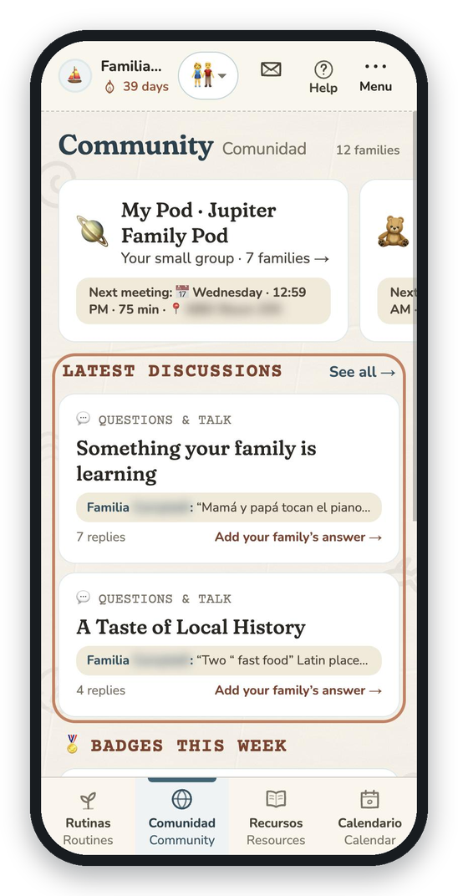 <b>Community home</b>: pods, the latest discussions, and this week's badges</td>
    <td align="center" width="33%">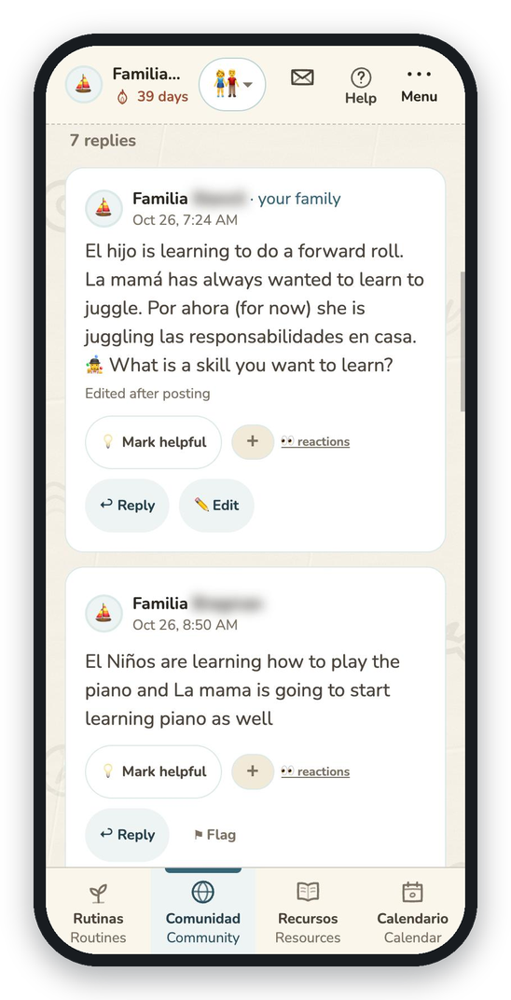 <b>Discussions</b>: real families replying in mixed Spanish and English</td>
    <td align="center" width="33%">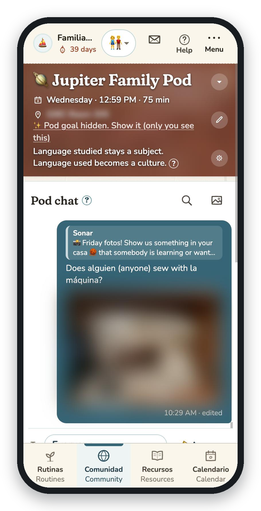 <b>Pod chat</b>: realtime chat with photos, replies, and host announcements</td>
  </tr>
  <tr>
    <td align="center">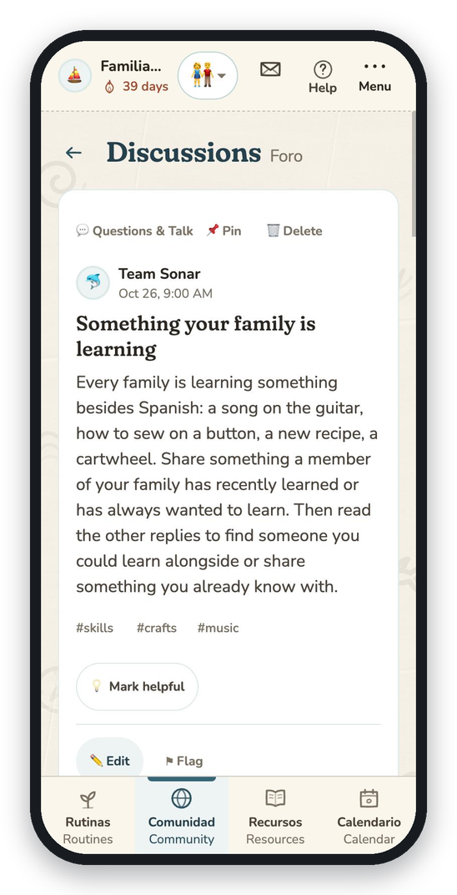 <b>Weekly prompt</b>: teaches one thing, then asks for one small thing</td>
    <td align="center">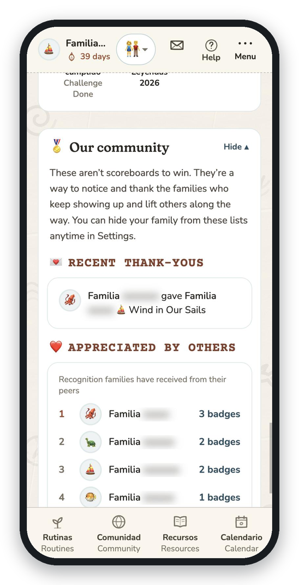 <b>Peer recognition</b>: families thank each other with badges</td>
    <td align="center">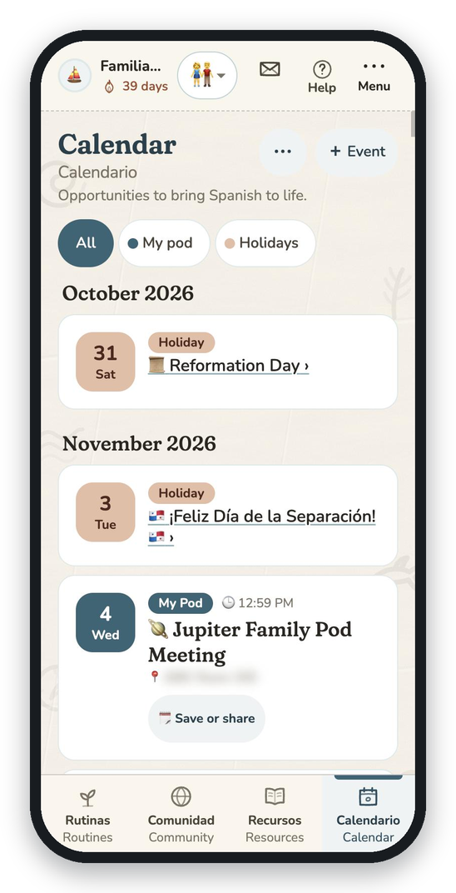 <b>Calendar</b>: pod meetings, cultural holidays, and RSVP</td>
  </tr>
</table>

### 3. Content that teaches while it entertains

**Dives** are short illustrated reading courses about the Spanish-speaking world (bottle cap baseball in the Dominican Republic, reed boats on Lake Titicaca). The English text has Spanish woven in at each family's level. **Tap any Spanish word** to hear it, see what it means, and read it in a sentence. The app tracks which words each person has seen and tapped, so new words show up gradually as old ones stick.

<table>
  <tr>
    <td align="center" width="33%">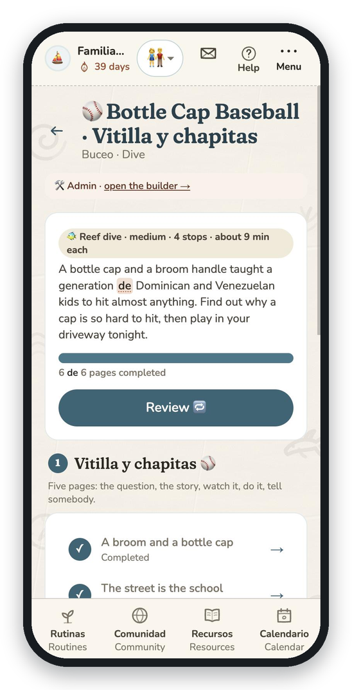 <b>Dives</b>: short illustrated courses with progress tracking</td>
    <td align="center" width="33%">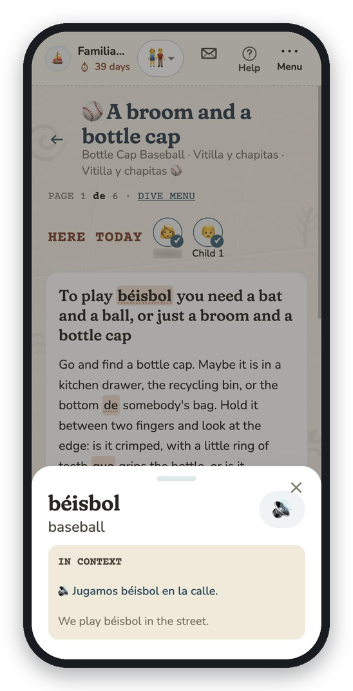 <b>Tap a word</b>: audio, meaning, and an example sentence</td>
    <td align="center" width="33%">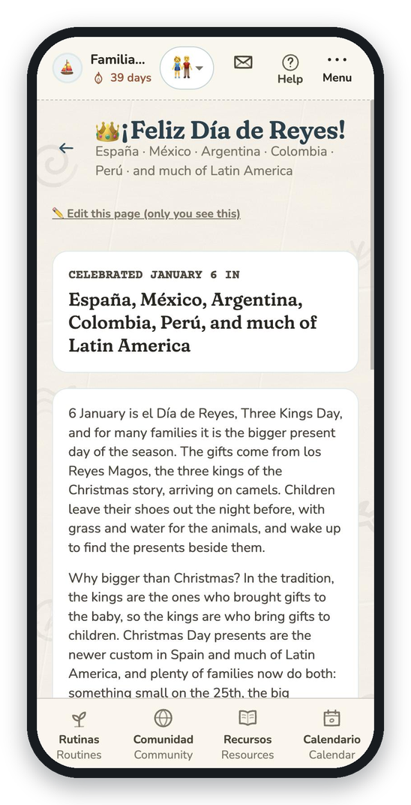 <b>Holidays</b>: 79 cultural days, each with a printable reflection page</td>
  </tr>
</table>

### 4. A resource library matched to each family

Shows, books, podcasts, and songs are tagged by level, age, and format. Recommendations come from each family's profile, and a resource can become a habit in one tap. The **Phrasebook** groups everyday sentences by when you'd say them ("getting ready", "the drive", "dinner"), with audio and singular or plural forms.

<table>
  <tr>
    <td align="center" width="33%">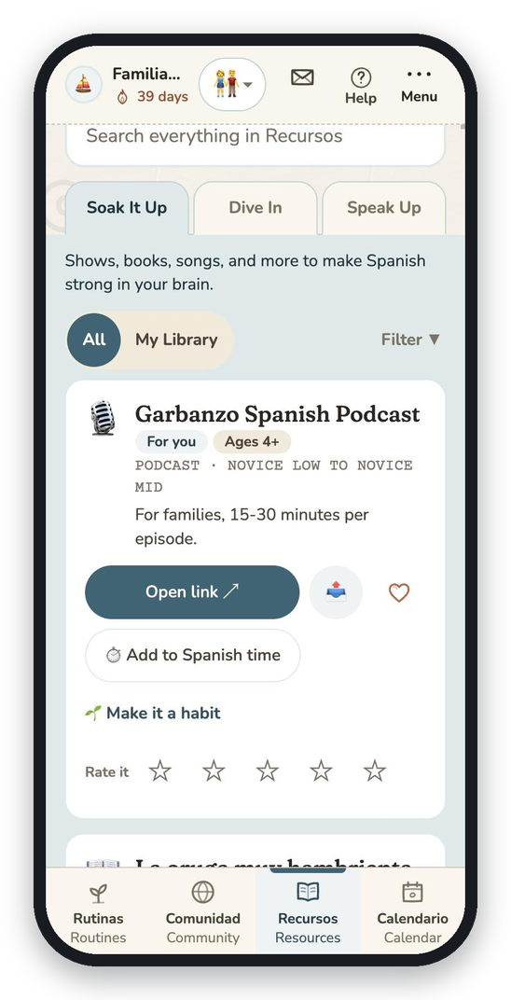 <b>Soak It Up</b>: a leveled library with "For you" picks</td>
    <td align="center" width="33%">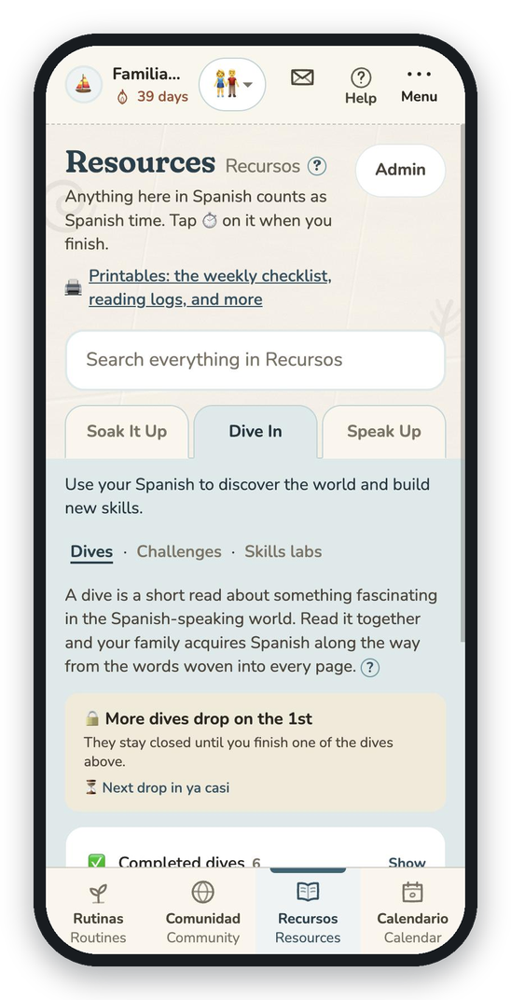 <b>Dive In</b>: dives, challenges, and skills labs</td>
    <td align="center" width="33%">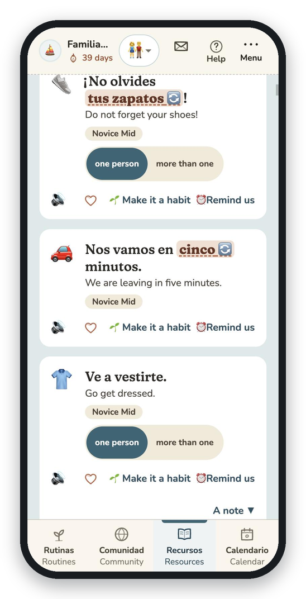 <b>Phrasebook</b>: sentences for daily moments, with reminders</td>
  </tr>
</table>

### 5. Progress for the whole household

The goal is a **proficient family**, not just a fluent child. Each person in the house has a level on the ACTFL proficiency scale, set by a short self-check they can retake, and a path to the next level. Kids get their own profiles without needing their own logins.

<table>
  <tr>
    <td align="center" width="33%">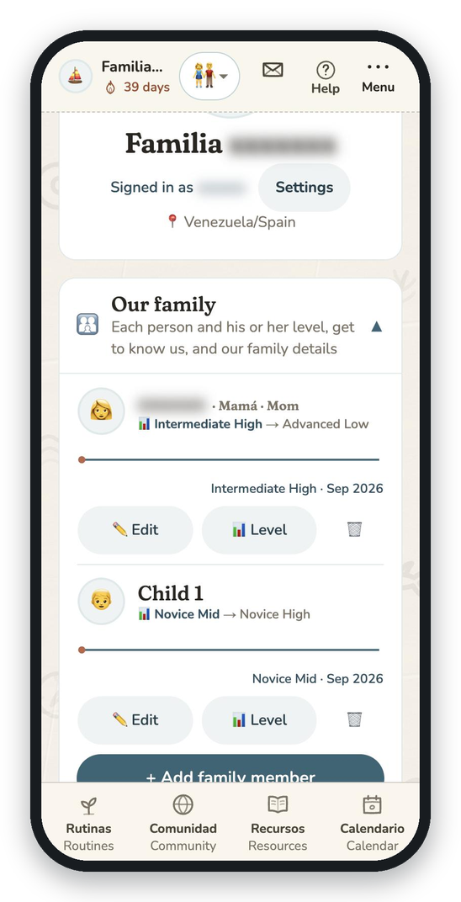 <b>Family profile</b>: each person's ACTFL level and next step</td>
    <td align="center" width="33%"></td>
    <td align="center" width="33%"></td>
  </tr>
</table>

### 6. Tools for the teacher ⭐

This part is what makes Sonar a product for programs, not just a family app. Admin and host tools sit right on the pages they manage, behind an edit pencil only the host can see, with a few cross-cutting dashboards on top.

<table>
  <tr>
    <td align="center" width="33%">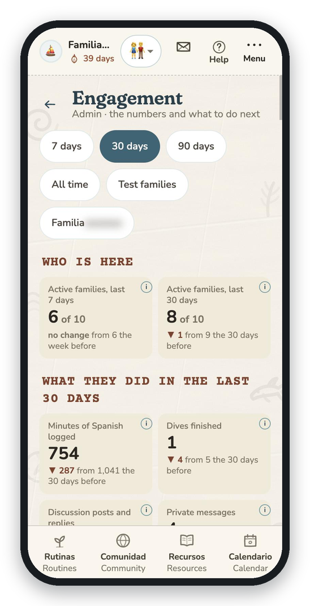 <b>Engagement dashboard</b>: active families, minutes, posts, and messages, compared with the previous period</td>
    <td align="center" width="33%">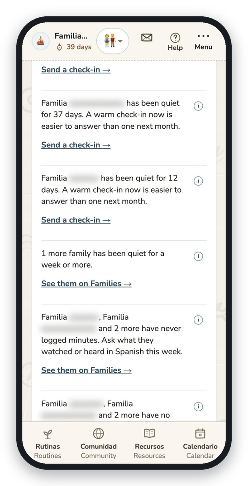 <b>"What to do this week"</b>: who has gone quiet, with a one-tap check-in</td>
    <td align="center" width="33%">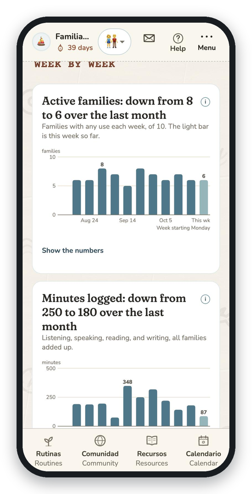 <b>Week-by-week trends</b>: participation and minutes over time</td>
  </tr>
  <tr>
    <td align="center">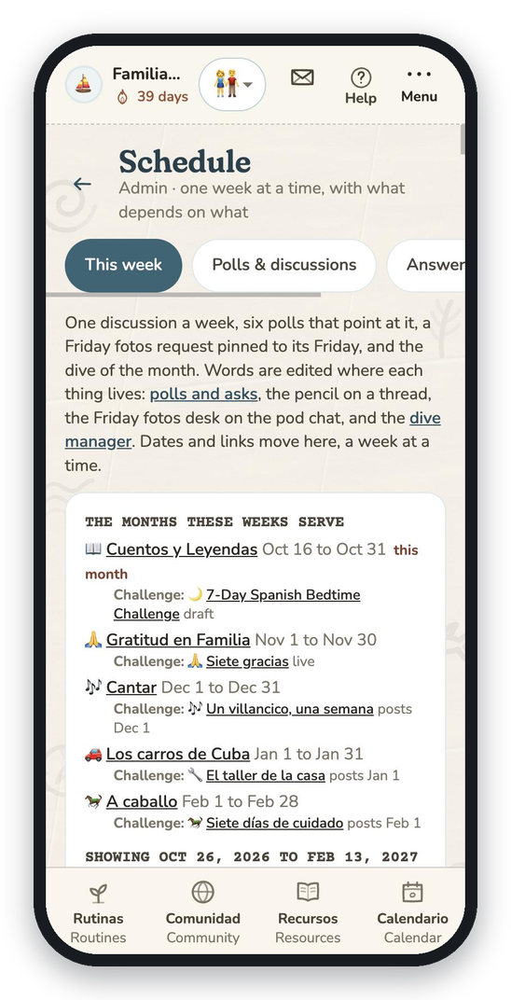 <b>Content calendar</b>: monthly themes, polls, discussions, and challenges, planned a week at a time</td>
    <td colspan="2">

**Also included for hosts and admins**

- Pinned announcements to one pod or several at once
- Attendance, lesson picker, family notes, and a leader guide for each pod
- Resource manager for tagging by interest, age, and level
- A dive builder and challenge builder
- Feature flags: new experiences go to an admin-only preview before families see them
- Moderation: flagging, community agreement, and post removal
- Printable handouts (weekly checklist, reading logs, conversation cards) generated from the same data the app uses

</td>
  </tr>
</table>

---

## Architecture

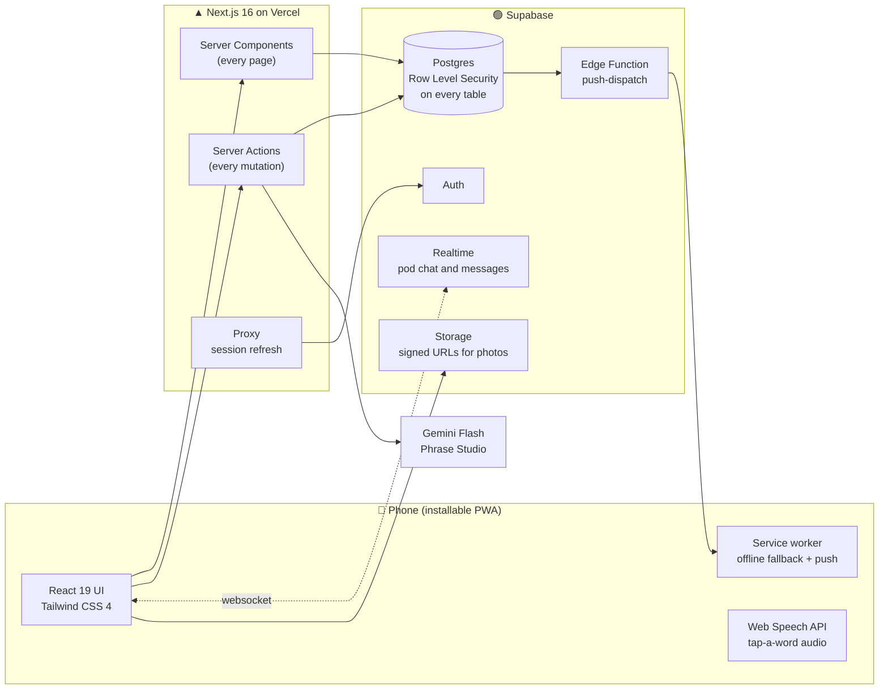

| Layer | Choice | Why |
|---|---|---|
| **Framework** | Next.js 16 App Router, React 19 | Server Components fetch data close to the database. Server Actions handle mutations with no separate API layer. |
| **Data and auth** | Supabase Postgres + Auth | **Row Level Security is the only authorization layer.** No service key ships, so every read and write is checked in the database. |
| **Realtime** | Supabase Realtime | Pod chat and family-to-family messages update live. |
| **Styling** | Tailwind CSS 4 over design tokens | One shared vocabulary for boxes and pills, checked by a lint script. |
| **Mobile** | PWA (manifest, service worker, web push) | Installs to the home screen on iOS and Android with no app store. |
| **AI** | Gemini Flash | The Phrase Studio turns a family's own English sentence into natural Spanish, with guardrails on what it can return. |
| **Print** | Python + ReportLab | Printable handouts are built from the same sentence lists the app reads aloud, so paper and screen never drift apart. |
| **Hosting** | Vercel + Supabase | Serverless rendering next to a managed Postgres, with schema changes shipped as ordered SQL migrations. |

## Engineering highlights

- **Security in the database.** Every table has RLS policies. Roles (family, pod host, admin) are enforced in Postgres, not in the UI, which matters for an app with minors in it.
- **600+ migrations, kept honest.** The TypeScript types are maintained against the live schema and change in lockstep with each migration. Data changes move old rows forward so active families never lose work.
- **A lexical engine.** It tracks the top Spanish words by frequency for each person, using five behavioral signals and spaced recycling. The interface gradually switches common words into Spanish as a family shows it knows them.
- **Editorial rules as code.** A suite of audit scripts enforces the product's voice and content rules on every change: regional Spanish neutrality, emoji policy, the Oxford comma, a consistent surface vocabulary, and length and structure checks on courses.
- **Safe rollouts for live users.** New experiences go behind admin-only feature flags. Each change is planned around what a family who is already active will see the day it ships.
- **Research behind every screen.** A "why" tip on each screen explains the acquisition research behind the feature, so families and teachers know why it works.

## What I learned

- **Engagement is a content problem as much as a features problem.** A predictable weekly rhythm (one discussion, six polls that point at it, one photo prompt) gives a small community something to talk about every day without burying anyone.
- **Design for the people already here.** Shipping to a live community means every migration, rename, and new flow has to work for someone who already set things up the old way.
- **Put authorization where the data is.** Making RLS the only access layer forced clearer data modeling and removed a whole class of bugs.
- **Teachers need "what to do next", not just charts.** The dashboard ends in a short list of families to check in with this week, because a number nobody acts on doesn't help.

## Re-platforming note

Sonar started as an Expo / React Native app and was re-platformed to a Next.js PWA: one codebase that installs to the home screen with no app store, and a real web surface for the teacher tools. Every feature was ported, and the native codebase is preserved at a git tag.

---

**Sonar Language** · [app.sonarlanguage.com](https://app.sonarlanguage.com) (invite only)

The source is private. I'm happy to walk through the code, the schema, or the RLS design on request.

